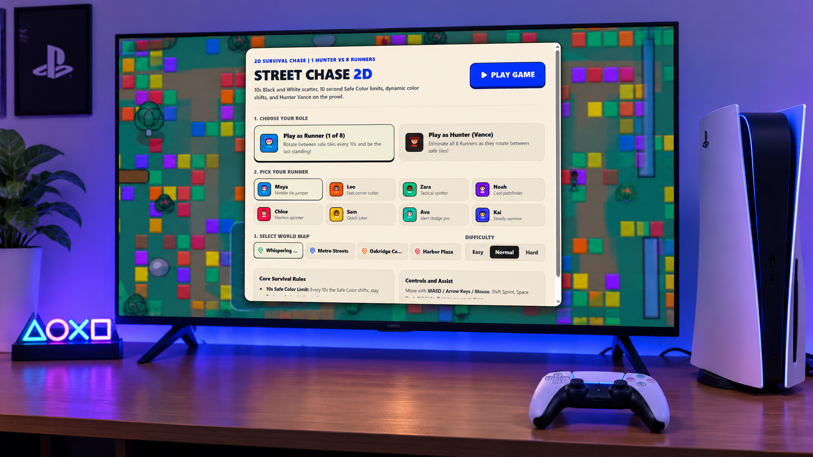

# 🎮 Street Chase 2D

**A colorful 2D survival chase game for children aged 5+.**



Eight runners. One hunter. One simple rule: **Stand on the Safe Color.**

Built with Google AI Studio.

---

## About the Game

Street Chase 2D is a 1 Hunter vs. 8 Runners survival chase game that runs directly in your browser.

For the first 10 seconds, the entire map appears in black and white. Runners scatter and try to stay away from Hunter Vance.

When the colors reveal, a **Safe Color** appears at the top of the screen. It changes every 10 seconds.

- Stand on a tile matching the Safe Color to stay protected from the hunter.
- Move quickly before the next color change.
- Avoid Hunter Vance and survive as long as possible.
- If caught, your round, score, and survival time are displayed.

You can play as a **Runner** (choose from 8 characters) or become the **Hunter** and try to catch all 8 runners.

## 🎯 Target Audience

**Primary:** Children aged 5 and above.

**Secondary:** Families and parents looking for a fun, quick, and engaging game for young children.

The game focuses on one simple concept: matching colors. With bright tiles, a clean HUD, and minimal reading, children can understand the rules within seconds.

## 💡 Problem Statement

Many games designed for young children are either too simple to hold their attention or too complex for them to enjoy independently.

Long instructions, crowded screens, and complicated controls can make gaming difficult for children who are just beginning to read and play.

Young players need something they can understand quickly while still offering excitement, challenge, and replayability.

## 🚀 Our Solution

Street Chase 2D transforms one simple rule — **find the Safe Color** — into an exciting survival chase.

- **Easy to Understand:** The map transitions from grayscale to colorful, with the Safe Color clearly displayed at the top.
- **Dynamic Gameplay:** A hunter chases the runners while the Safe Color changes every 10 seconds.
- **Stamina Management:** Sprinting and dashing require stamina, adding another layer of strategy.
- **Character Variety:** Choose from 8 unique runners.
- **Multiple Environments:** Explore 4 different maps.
- **Adjustable Difficulty:** Play on Easy, Normal, or Hard.
- **Kid-Friendly Options:** Enable tile color letters, voices, in-game rules, and pause controls.
- **No Installation Required:** Play directly in your browser.

## 🕹️ How to Play

| Action | Control |
|---|---|
| Move | WASD / Arrow Keys / Mouse |
| Sprint | Shift |
| Dash | Space |
| Hide | E |
| Pause | P |

**Tip:** Watch the countdown at the top of the screen. When it reaches zero, the colors reveal. Be ready to move to the Safe Color!

## ✨ Features

- 1 Hunter (Hunter Vance) vs. 8 Runners
- Play as either a Runner or the Hunter
- 8 playable runners:
  - Maya
  - Leo
  - Zara
  - Noah
  - Chloe
  - Sam
  - Ava
  - Kai
- 4 unique maps:
  - Whispering Woods
  - Metro Streets
  - Oakridge Campus
  - Harbor Plaza
- 3 difficulty levels: Easy, Normal, and Hard
- Live HUD displaying:
  - Current round
  - Runners remaining
  - Score
  - Safe Color countdown
  - Hunter distance
  - Stamina
- Interactive minimap
- Tile color letter indicators
- Voice options
- In-game rules and pause menu
- Game Over summary with Play Again and Main Menu options

## 🛠️ Tech Stack

| Technology | Purpose |
|---|---|
| Vite | Development and build tooling |
| TypeScript | Game logic and application code |
| HTML | Game structure |
| Google AI Studio | AI-assisted game development |

## ⚙️ Getting Started

### Prerequisites

- [Node.js](https://nodejs.org/) installed on your system.
- Git installed on your system.

### Installation

**1. Clone the repository**

```bash
git clone https://github.com/Humaira123-afk/Street-Chaser-2D.git
cd Street-Chaser-2D
```

**2. Install dependencies**

```bash
npm install
```

**3. Start the development server**

```bash
npm run dev
```

**4. Open the game**

Open the local URL displayed in your terminal.

If the project requires environment variables, copy `.env.example` to `.env.local` and configure the required values.

## 📁 Project Structure

```text
Street-Chaser-2D/
├── public/
│   └── assets/
│       └── aistudio/       # Static assets
├── src/                    # Game source code
├── index.html              # Application entry point
├── metadata.json
├── package.json
├── tsconfig.json
├── vite.config.ts
└── .env.example
```

## 👥 Credits

Made by **Humaira and Team** for a hackathon using Google AI Studio.

---

**Street Chase 2D — Find the color. Escape the hunter. Survive the chase!**
